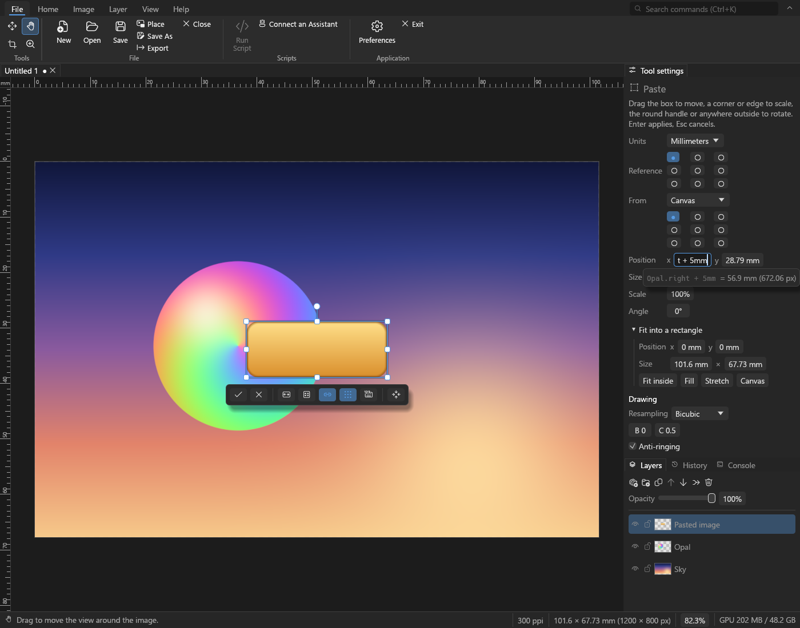

# Opal Studio

> **Pre-alpha.** Opal Studio is in early development: much of what is planned is not built
> yet, the `.opal` file format and the scripting interface may still change, and it has
> not been tried widely. Do not trust it with work you cannot afford to lose.

A 2D graphics editor that aims to be more intuitive than the usual ones: everything stays
editable, every setting that affects a result can be adjusted, and the interface always
says what a command does and, when it cannot run, why.



Milestones 0 (the foundation), 1 (paste and place), S (scripting and MCP) and E
(expressions) of the roadmap are built. You can open and create images, paste and place
images, move, scale, rotate, crop and resize, arrange and merge layers, type arithmetic
that names other layers into any number field (`Logo.right + 5mm`) and have a layer
placed so again once they move, undo through a branching history, save and export, and
drive it all from Python scripts or an AI assistant; selections and painting come next. See `roadmap.md` for what is planned
and `design.md` for how it is built. Known problems are listed in `known-issues.md`.

Free software under the GNU General Public License, version 3 or later (`LICENSE`).

## Downloading

Windows builds are on the [releases page](https://github.com/inhahe/OpalStudio/releases):
unzip one anywhere and run `opal-studio.exe` (`opal-studio.com` is the same program for a
command prompt, which waits for it). The `python` folder in it is the `opal` package for
scripts (see *Scripting* below).

## Building and running

Needs Rust 1.95 or later. On Windows, the Visual Studio C++ build tools as well: the
project builds for the MSVC target (`.cargo/config.toml`).

```
cargo run -p opal-app --release            # start Opal Studio
cargo run -p opal-app --release -- a.png   # and open files
cargo test --workspace                     # all tests, interface tests included
```

## What works so far

- **Files.** Open PNG and JPEG (8 and 16 bits; EXIF orientation honored) and Opal
  Studio's own `.opal` files, which keep every layer, the selections saved and the metadata. An 8-bit image takes half the
  memory until it is changed: its pixels are kept as they were read. Images larger than
  memory can be worked on, saved and opened again: past a share of it (a preference), or
  past what is free while something needing memory is done, the parts not looked at
  lately go to a scratch file on disk. Save as `.opal`;
  export the canvas to PNG (8 or 16 bits) or JPEG, at its own size or another. Saving and
  exporting run in the background, so the window stays usable; the status bar shows how far
  they have got and can cancel them. A save that fails or is cancelled never damages the
  existing file. Drop files on the window to open them; several images open as tabs.
- **Units and resolution.** Sizes and positions can be shown and typed in pixels,
  points, picas, inches, feet, yards, millimeters, centimeters or meters (Preferences ›
  Interface, or the menu beside any size): every image has a resolution (pixels per inch,
  or per centimeter) that converts them, read from PNG and JPEG files (one that does not
  say gets a preference's, 72 unless changed) and written back on export; the status bar
  shows it, and clicking it changes it. A length typed with a unit after it ("21 cm") is read in that unit whatever the
  field shows. New Image has paper and photo sizes; Resize Image changes the resolution,
  with or without changing the pixels.
- **Expressions in every number field.** Any field that takes a number takes arithmetic
  too, in mixed units (`2in + 3mm`, `width / 2`), naming the canvas and layers
  (`Logo.right + 5mm`, `canvas.center.x`, `layer("Back ground").height`) and the box's own
  numbers (`x + 1cm`). What it comes to shows as you type, or what is wrong and where;
  Up and Down bring back what was entered before, in this session or an earlier one.
  `min`, `max`, `round` (`round(x, 1mm)`),
  `sqrt`, the trigonometric functions, `mid`, `lerp` and `dist` are there too. A layer
  placed by a box given expressions that name the canvas or other layers remembers them:
  once those have moved, Re-apply Placement (Home › Transform, or the box's numbers, under
  Placed by) puts it where they say now, and Re-apply All Placements does so for every
  layer, each after those it is placed relative to (layers placed relative to each other in
  a loop are left as they are, and said).
- **Metadata.** What a photograph's file says besides its pixels (the camera's EXIF, IPTC,
  XMP) is kept: through the `.opal` file, to export. Image › File Info (Ctrl+Shift+Alt+I)
  shows how it was taken (camera, lens, exposure, when, where) and edits its title,
  caption, creators, contact, copyright and keywords, written to all three as other
  programs read them; templates fill in the creator's and copyright fields at once. Export's
  Metadata setting chooses what goes out: all of it, all but where it was taken and serial
  numbers (the default), copyright and contact only, or none. Whatever goes says the image
  is upright and the size it was exported at. Scripts read and change all of it
  (`metadata`, `set_metadata`), and a JPEG's or PNG's without opening it
  (`file_metadata`, `set_file_metadata`: rewritten in place, no quality lost).
- **Paste and place.** Ctrl+V pastes an image (from Opal Studio, another program, or an
  image file copied in Explorer) into a box that moves, scales and rotates it, snapping to
  the canvas and other layers; Enter places it. A pasted image keeps its own pixels, so it
  can be resized again later without losing quality. The numbers button by the box (and
  the tool settings) gives its exact position, size and angle, in any unit, measured from
  any of nine points of the box, counted from any of nine points of the canvas or of another
  layer, and fits it inside, or makes it fill, a rectangle you type, keeping its
  proportions. Place (File)
  puts an image file in the box the same way, at its print size (scaled by its resolution
  against the image's) unless a preference says pixel for pixel; a button on the box
  switches between the two. Open as Layers (File) brings in several image files at once,
  a layer each, centered, selected and ready to align; with nothing open, they make a new
  image the size of the first. Paste in Place, Copy and Copy Merged;
  pasting with nothing open makes a new image. Copies keep their full precision when pasted
  back, and on Windows reach other programs as 16-bit PNG. A large image, pasted, opened,
  placed or opened as layers, is read in the background, the window answering meanwhile
  (Esc cancels it): anything started meanwhile (a dialog, a drag, another box) is
  finished first.
- **Moving and transforming.** The Move tool drags the selected layers (clicking picks the
  layer under the pointer; right-click lists every layer there); the arrow keys nudge;
  Transform (Ctrl+T) scales and rotates layers, losslessly; Transform Again (Ctrl+Shift+T)
  does the same again, to the layers selected now, and Transform Again as a Copy
  (Ctrl+Shift+Alt+T) to copies, a press at a time, a row or a ring of them. Layer › Align (and the Move
  tool's settings) lines the selected layers up by their edges or centers, and spaces their
  centers or the gaps between them evenly: to each other, the canvas, the selection, or the
  active layer (Align to); with the transform box open, it aligns the box (a paste, centered
  on the canvas).
- **The image.** The Crop tool, with aspect ratios, guides and straightening, and its box's
  exact numbers by it as for the transform box; Crop to
  Content; Trim, by transparency or a corner's colour within a tolerance (a scan's white
  margin), from the sides you choose; Reveal All, which grows the canvas to show everything
  the layers hold; Resize Image and Resize Canvas; quarter turns, flips and rotation by any
  angle.
- **Measuring.** The Measure tool (N) measures between two points: the length, the angle
  (as a protractor reads it), the width and height, in any unit, shown on the image and in
  the tool settings, where numbers can be typed in too. Drag an end to move it, Shift for
  multiples of 45°, Alt+drag from an end for a protractor's second arm and the angle
  between. What is measured stays until the next measure, and goes with the image turned or
  resized. Image › Straighten turns the image so the line is level, or plumb, and crops it
  so no corner is left empty (or grows the canvas instead); Straighten Layers turns the
  selected layers instead.
- **Color samplers.** The Color Sampler tool (I) pins up to ten points on the image; the
  Info panel shows their colours (and the colour under the pointer) in sRGB or any other
  model you choose for each (HSB, HSL, Lab, LCh, OKLab, linear, a hex code…), averaged over
  as large a square as you like, and while an edit is shown before being applied, each value
  as it was beside it. They are kept in the image's file.
  Cropping and resizing the canvas never delete anything unless asked to. Canvases go up
  to 300,000 pixels a side; anything that would need more memory than the computer has
  free (counting room on disk for the parts that can go there) is refused, with how much
  it needs, rather than run out of it.
- **Selections** (in progress). A selection can be soft: each pixel is selected from not at
  all to fully, and everything acting on it acts on each pixel that much. So far: the Select
  tool (M), dragging rectangles and ellipses on whole pixels, or clicking for a single row or
  column of pixels the canvas across, Shift adding to the selection and Alt taking away; the
  Outline tool (L), a loop dragged freehand round what to select, or clicked point by point
  (a drag from the last point bending the side into a curve; Enter closes it, Backspace takes a
  point back), and the last outline edited with it: points dragged, added by a click on a side,
  taken away with Alt+click or Delete, made smooth or sharp with a double-click, their handles
  and sides dragged to bend them, the whole outline moved with Alt+drag from a point, a stretch
  of it drawn again with a right-drag (or R + drag) from it back to it, the nearer stretch
  between replaced, shown in red as you draw (Tab for the other); and
  symmetric outlines (Symmetry and Mirror in Tool settings): one slice drawn, completed by its
  copies turned round a center, mirrored across an axis, or both, the center and axis dragged
  on the image, its points edited and stretches redrawn on any copy; Select All, Deselect,
  Reselect and Invert Selection; a layer's pixels
  selected by Ctrl+clicking its thumbnail (with Shift to add, Alt to take away); Clear, Cut and
  Copy within it (saying why, when they change nothing you can see: a layer hidden, at 0%
  opacity or locked, no pixels there, a layer above covering them, named, a layer too faint,
  or what lies beneath looking the same); Layer via Copy
  (Ctrl+J) and Layer via Cut; Crop to Selection; Transform Selection (the
  selection itself moved, sized or turned in the transform box); marching ants round it. The last shape keeps a box whose handles
  move, size and turn it, and whose numbers button gives its exact position, size and angle,
  in any unit; scripts select shapes so too (`select_rectangle`, `select_ellipse`). View ›
  Selection Overlay shows what is not selected under red, fading with a soft selection. Grow
  or Shrink (round, square or diamond corners), Feather (inward, outward or centered;
  Gaussian or straight), Smooth (pinholes, specks and jagged corners gone) and Border (a band
  along the outline) change its edge, shown as you set them. The Selection panel lists the
  steps that made the selection: change a modifier's settings, how a shape combines, or take a
  step away, and the selection is worked out again from them. Save Selection keeps one under
  a name in the image and its file; Load Selection brings it back, or adds it to what is
  selected, takes it away, or keeps what is in both, inverted if you like.
  Selections are part of history, and turn, flip and resize with the image.
- **Layers and groups.** Add, duplicate, delete, group, reorder (buttons or dragging,
  into and out of groups; Bring to Front and Send to Back within each group, Reverse),
  rename, hide, lock, change opacity; select several with Ctrl and Shift, or all of them
  (Ctrl+Alt+A), or none; merge down, merge selected, merge visible, merge a group, stamp visible,
  flatten; rasterize; thumbnails. Layers have no edges: content past the canvas is kept and
  shown dimmed.
- **Matting.** Set right the edges of something cut out of one background and put on
  another: Defringe gives the outer pixels the colour of those further in, and Remove Black
  Matte and Remove White Matte take back out of a soft edge the black or white it was
  blended with.
- **Long edits in the background.** Merging, flattening, rasterizing, rotating, flipping,
  resizing and straightening a large image are worked out in the background: the window
  stays usable, and the status bar shows how far the edit has got, with Cancel. That image
  can't be changed until it is done (its commands say why), but you can look at it, copy
  from it, and work on other images.
- **History.** Doing something new after undoing starts a branch instead of discarding the
  redo states, and the History panel goes to any state on any branch. History may use a
  set amount of memory (a preference); past it, the oldest states and abandoned branches
  are dropped, never the newest work.
- **Viewing.** Zoom with the wheel, the Zoom tool, pinching or the zoom commands; scroll
  with the Hand tool, Space-drag or the middle button. Turn the view (not the image), as a
  drawing is turned on a desk, with the Rotate View tool, by holding R and dragging with any
  other tool, by typing an angle, or a step at a time from the View tab; Esc with the tool,
  or Reset Rotation, puts it straight. F goes full screen, then shows the
  image alone with nothing round it, then back. The image is drawn on the GPU in
  linear light, smoothly when zoomed out and as sharp pixels when zoomed in. Rulers along
  the top and left of the view (View › Rulers, Ctrl+R) count from the canvas's corner in
  the unit sizes are shown in, and mark where the pointer is.
- **Comparing.** View › Tile All shows every open image at once, in a grid laid out to
  show them largest, and Consolidate to Tabs puts them back. Match Zoom and Location
  shows the other images at the active one's zoom and place; Lock Views keeps them so
  while you zoom and scroll, to go over versions of a photograph together. Open Reference
  opens an image in a pane of its own beside the one you are editing, to match its look.
  Before and After splits the view by a line you drag: left of it, the image as it was
  opened or made (or any state of its history: right-click the state in the History
  panel and choose Compare with This State), right of it, as it is now; Esc ends it.
- **The interface.**
  - A ribbon of commands whose groups shrink to fit the window, with tooltips that say
    why a disabled command cannot run.
  - Alt shows a letter on every tab and button; Ctrl+K searches for any command; F1
    opens help for the button under the pointer.
  - While a mouse button is held on the image, keys that would change it do nothing (the
    status bar says so); Esc, Space, the zoom keys and Ctrl+R (the rulers) still work.
  - Tools are pinned to the ribbon or a side strip.
  - Every preference shows its default, marks changes and can be reset, and tool
    settings can be saved as named presets.
  - Dark and light color schemes.
- **Scripting.** Python scripts can drive the running editor through the `opal` package in
  `python/` (put it on `PYTHONPATH`, or `pip install ./python`):

  ```python
  import opal
  with opal.connect() as editor:
      editor.new(width=1920, height=1080)
      editor.new_layer(name="Sky")
      editor.export(path="sky.png")
  ```

  Most commands can be called this way, with their settings as named parameters, as can
  the queries `documents`, `layers` and `image` (what an image looks like, as a PNG);
  `python/API.md` lists them all. Sizes and positions take any unit, at the image's
  resolution (`editor.new(width="8.5in", height="11in", resolution=300)`), and every
  number may be an expression, as in the fields, worked out when the call runs
  (`editor.transform(x="x + 1cm")`, `editor.place(path=p, x="Logo.right + 5mm")`), or
  built with the package's own `opal.layer`, `opal.canvas`, `opal.box`, `opal.fn` and
  units (`x=opal.layer(logo).right + opal.mm(5)`); `place`,
  `paste` and `transform` take the box's exact position and size (fitted inside or
  covering a rectangle, if asked), `crop` a rectangle, and `preferences` and
  `set_preference` read and change the preferences (but for those of scripting). `editor.pixels()` gives an image's pixels, or a layer's,
  as a numpy array, and `editor.put_pixels(array)` puts some in, as a new layer or into a
  layer; on Windows they pass through shared memory, so even large images move at once.
  What a script changes in an image becomes one history state, named after it, when it
  ends, so one undo takes it back (from an interactive Python session, or with
  `connect(script=None)`, each call is a history state of its own); `with editor.step("name"):`
  makes the calls inside it one step of their own, and `editor.history()` gives an image's
  undo tree. With no editor running, `opal.connect()` starts one of its own with no
  window, which ends with the script, so `python script.py` works whether or not Opal
  Studio is open; `connect(windowless=True)` always does, leaving your open images alone.
  Only programs of the user's own
  can connect (through a token in the settings folder), and the status bar says when one is
  connected, with a button to disconnect it (which keeps scripts out until you let them in
  again there). Run Script (File › Scripts) runs one from the editor, with the Python set
  in Preferences › Scripting (a virtual environment's, say, or `py -3.12`); the Console
  panel shows what it prints, can stop it, and runs it, or another of the scripts run
  lately (its Recent menu), again.
- **Batch work.** `opal-studio --headless script.py [arguments]` runs a script against an
  editor with no window (the Python is `--python PATH`, or `OPAL_PYTHON`, or the one set in
  the preferences), and ends with the script's exit code once the files it asked for are
  written. As with Python itself, `-c "code"` runs code given on the command line, and `-`
  a script read from standard input. Nothing needs the window: everything a script needs
  (placing files, exact boxes, cropping, the preferences) has a method. From a command prompt, run it as `opal-studio` (not `opal-studio.exe`), so that
  the prompt waits for it: that finds `opal-studio.com`, which waits.
- **AI assistants.** `opal-studio --mcp` is an MCP server for assistants whose clients
  launch their servers, its tools the same commands and queries, the image coming back as
  an image so the assistant sees what it is doing. For Claude Code, for example:
  `claude mcp add opal-studio -- "C:\path\to\opal-studio.exe" --mcp`. For clients that
  connect by URL, Preferences › Scripting can serve MCP over HTTP on this computer, with a
  token. Connect an Assistant (File › Scripts) shows what to put in a client's settings
  either way. With no editor running, `--mcp` starts one of its own with no window, and
  says so: what it makes lasts as long as the server, so save or export it.

## Layout

| Crate | What it holds |
|---|---|
| `crates/opal-color` | Color models and conversions (a port of the author's colorpicker, plus OKLab). |
| `crates/opal-core` | The document: tiles, layers, the history tree, compositing, curves. |
| `crates/opal-io` | PNG and JPEG import and export, and the `.opal` format. |
| `crates/opal-app` | The application: interface, canvas rendering, settings, the scripting API. |
| `python` | The `opal` package for scripts, and the API's reference (`API.md`). |
